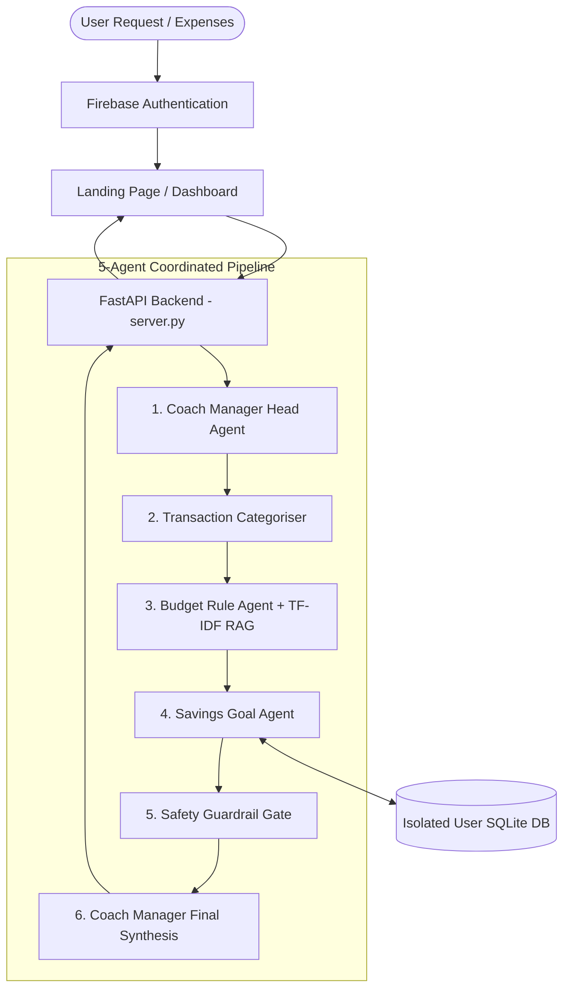

# 🏦 Personal Finance Budget Coach

> An AI-powered personal finance management and budget coaching application driven by a coordinated **5-Agent Autonomous Pipeline**, educational **50/30/20 rule** guidelines, **account-isolated SQLite persistent memory**, and a modern fintech dashboard.

---

## 🌟 Key Features

- **Autonomous 5-Agent Pipeline**:
  1. **Coach Manager (Head Agent)**: Central orchestrator managing workflow dispatch, agent coordination, and final executive report synthesis.
  2. **Transaction Categoriser Agent**: Automatically classifies user expenses into *Needs*, *Wants*, or *Savings*.
  3. **Budget Rule Agent**: Applies the 50/30/20 budgeting rule using educational guidelines retrieved via **TF-IDF vector search (RAG)**.
  4. **Savings Goal Agent**: Computes progress toward long-term savings goals and logs contributions into SQLite persistent memory.
  5. **Safety Guardrail Agent**: Audits all generated advice, strictly blocking investment speculation, stock picks, or tax evasion advice.

- **Account-Isolated SQLite Memory**:
  - Each registered user has their own private SQLite database (`memory/users/savings_{user_id}.db`).
  - When returning users log in, all past recorded months, transactions, and savings goals are restored.
  - New user registrations start with a completely clean, isolated workspace.

- **Firebase Authentication**:
  - Full Google Sign-In popup integration.
  - Email & Password sign-up and sign-in.
  - Protected dashboard: landing page gatekeeper requires authentication before workspace access.

- **Modern Fintech UI/UX**:
  - Designed with clean fintech aesthetics: `#F1F1F1` background, `#FFFFFF` cards, `#F2643D` coral accent, and `#22221E` charcoal text.
  - Multi-month comparison bar chart with dual-sync filtering.
  - Live progress bars for 50/30/20 distribution, spending limits, and savings goals.
  - Full agent execution trace tab showing each agent's role, task, and tools executed.

---

## 🏗️ Architecture Overview



---

## 🚀 Getting Started

### Prerequisites

- **Python 3.11+**
- **Node.js 18+** & npm
- A **Groq Cloud API Key** ([console.groq.com](https://console.groq.com))
- A **Firebase Project** ([console.firebase.google.com](https://console.firebase.google.com))

---

### 1. Backend Setup

1. **Clone the repository**:
   ```bash
   git clone https://github.com/pathakkrishna/Budget-Coach.git
   cd Budget-Coach
   ```

2. **Create and activate a virtual environment**:
   ```bash
   python -m venv .venv
   # Windows:
   .venv\Scripts\activate
   # macOS/Linux:
   source .venv/bin/activate
   ```

3. **Install dependencies**:
   ```bash
   pip install -r requirements.txt
   ```

4. **Configure Environment Variables**:
   Copy `.env.example` to `.env` and enter your Groq API key:
   ```env
   GROQ_API_KEY=your_groq_api_key_here
   GROQ_MODEL=openai/gpt-oss-20b
   ```

5. **Start the FastAPI Backend**:
   ```bash
   python -m uvicorn server:app --host 127.0.0.1 --port 8000 --reload
   ```
   The backend API will run at `http://127.0.0.1:8000/`.

---

### 2. Frontend Setup

1. **Navigate to the frontend folder**:
   ```bash
   cd frontend
   ```

2. **Install dependencies**:
   ```bash
   npm install
   ```

3. **Configure Firebase**:
   Copy `.env.example` to `.env` and fill in your Firebase project credentials:
   ```env
   VITE_FIREBASE_API_KEY=your_api_key
   VITE_FIREBASE_AUTH_DOMAIN=your_project.firebaseapp.com
   VITE_FIREBASE_PROJECT_ID=your_project_id
   VITE_FIREBASE_STORAGE_BUCKET=your_project.appspot.com
   VITE_FIREBASE_MESSAGING_SENDER_ID=your_sender_id
   VITE_FIREBASE_APP_ID=your_app_id
   ```

4. **Start the Frontend Dev Server**:
   ```bash
   npm run dev
   ```
   Open **http://127.0.0.1:5173/** in your browser.

---

## 🧪 Running Tests

Run the full automated test suite verifying 50/30/20 calculations, RAG retrieval, savings memory, and safety guardrails:

```bash
python -m unittest tests/test_finance_coach.py -v
```

---

## 📄 License

This project is open-source and available under the [MIT License](LICENSE).
